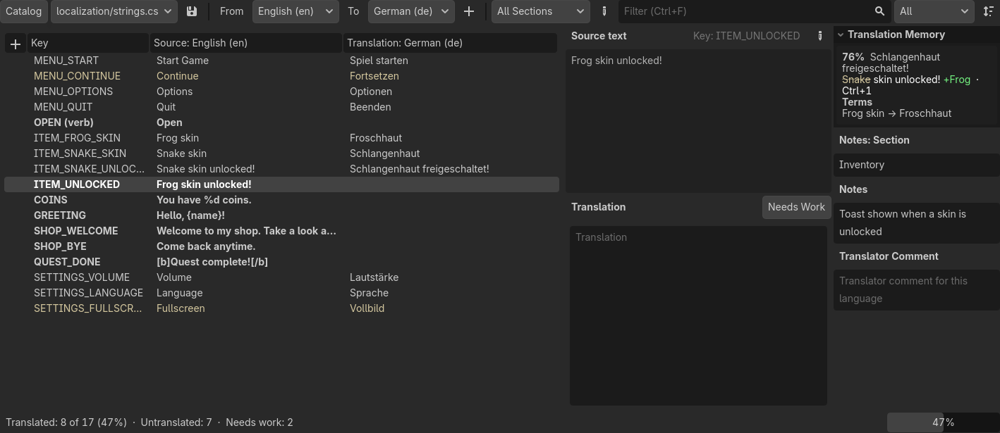
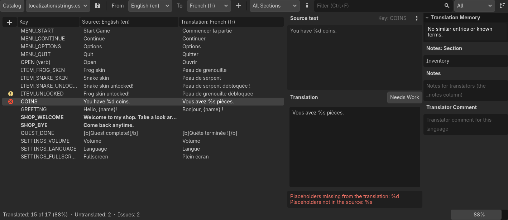

# Stele

Translation editor plugin for Godot 4.6+: Poedit's workflow for Godot's CSV translation files,
in a bottom dock inside the editor. Named after the Rosetta Stone, a stele with one text in three scripts.



- **One entry at a time**, the way Poedit works: the source text, its notes and context on one
  side, the translation on the other, and Ctrl+Enter to move to the next unfinished entry.
- **Translation memory** from every translation CSV in the project: close matches with what
  differs highlighted, and known terms ("Frog skin → Froschhaut") to insert with a click.
- **Checks as you type**: placeholders (`%d`, `{name}`), BBCode tags, line breaks, whitespace,
  end punctuation and duplicate keys, the same kinds of checks Poedit runs.
- **Needs Work flags** and translator comments, kept in a small file next to the CSV so the team
  shares them.
- **Sections** from a `_section` column (or any notes column), to work through one screen or
  scene at a time.
- **Plain CSV in, plain CSV out**: saving keeps columns, special rows and the byte order mark it
  doesn't touch, and reimports the file so the game shows the new text right away.

## Contents

- [Requirements](#requirements)
- [Install](#install)
- [Quick start](#quick-start)
- [Translating](#translating)
  - [Shortcuts](#shortcuts)
- [Checks](#checks)
- [The CSV file](#the-csv-file)
- [Working with a team](#working-with-a-team)
- [Troubleshooting](#troubleshooting)
- [Not supported (yet)](#not-supported-yet)
- [License](#license)

## Requirements

- Godot **4.6** or later (it uses the editor dock API added in 4.6).
- Translations in Godot's **CSV** format, imported as translations (the default for `.csv` files).
- Stele is editor-only. Your game uses the `.translation` files Godot's importer makes from the CSV,
  so exported games don't need the plugin.

## Install

1. Install **Stele** from the **AssetLib** tab at the top of the editor, which puts it in
   `addons/stele`. Or clone this repository into your project's `addons` folder as `stele`:
   ```bash
   git clone https://github.com/Reshiramoo/stele.git addons/stele
   ```
   (or add it as a submodule: `git submodule add https://github.com/Reshiramoo/stele.git addons/stele`).
   The folder must be named `stele`.
2. **Project → Project Settings → Plugins** → enable **Stele**. A **Stele** tab appears in the bottom panel.

## Quick start

Starting from nothing:

1. In the **Stele** tab, **Catalog → New Translation File…** and save it as, say,
   `res://localization/strings.csv`. It starts with a key column and English (`en`).
2. **Catalog → Add Language…** for each language you translate into (`ja`, `fr`, `pt_BR`…).
3. Add entries with the **+** in the list's header: a key (`MENU_START`) and its English text
   (`Start Game`).
4. Pick **From: English** and **To:** a language in the toolbar, then type each translation.
   **Ctrl+Enter** marks it done and jumps to the next unfinished entry.
5. **Ctrl+S** saves the CSV, and Godot reimports it into one `.translation` file per language.
6. If the status bar shows a warning button about languages not in **Project Settings →
   Localization**, click it: Godot only loads translations listed there.

Then use the keys in your game. Controls translate their text by themselves; in code use `tr()`:

```gdscript
$StartButton.text = "MENU_START"                        # translated automatically
$Coins.text = tr("COINS") % coins                       # "You have %d coins."
TranslationServer.set_locale("ja")                      # switch language at runtime
```

Already have a CSV? Open it from the file list in the dock's toolbar, right-click it in the
FileSystem dock → **Translate with Stele**, or select one of its `.translation` files.

## Translating

Open a file from the dock's file list (every CSV the project imports as translations), with
**Catalog → Open…**, by right-clicking a `.csv` in the FileSystem dock → **Translate with Stele**,
or by selecting one of its generated `.translation` files (it opens at that language).
Pick the source and target languages in the toolbar (**From** / **To**). The source can be the
key column itself, for files that only hold IDs. The dock remembers your choice for each file.

| Area | What it does |
|---|---|
| **List** | Every entry with its key, source text and translation; the **+** in the header's corner adds an entry. Untranslated entries are **bold**, Needs Work entries are yellow, and entries with issues get a warning or error icon. Filter by text, show All / Unfinished / Needs Work / With Issues / Translated, sort by file order, source or translation, with unfinished entries first if you like. Drag entries (or Alt+↑/↓) to reorder them in the file; right-click for Add, Rename, Edit Source Text, Delete, Move Up/Down, Move to Section, Needs Work and Copy Key. |
| **Sections** | A dropdown to work through one section at a time, with how many entries are left in each. Sections come from a `_section` column (or `_category`, `_group`, `_screen`, `_scene`, `_page`); pick another notes column or `?context` under **Sections From** in the sort menu. The **✎** menu next to it: **New Section…** (adds an entry in a new section, creating a `_section` column if the file has none), **Rename** the selected section (renaming to an existing name merges them), **Merge Into** another section (its entries move after that section's last one), **Remove** (keep the entries without a section, or delete them). Right-click an entry → **Move to Section** moves it to an existing or new section. New entries go into the section you're in; the Add Entry dialog has a Section field. All undoable. |
| **Source text** | The text to translate, its plural form, key and context. Click **✎** (or right-click the entry or the text → **Edit Source Text**) to edit it; Esc or ✎ again finishes. The edit is one undo step, and translations made from the old text are flagged Needs Work, as gettext does. With the key column as the source, this renames the key instead. |
| **Translation** | The editor. Plural entries get one tab per form. **Needs Work** flags a translation for review; editing it clears the flag, as in Poedit. Issues show up underneath as you type. |
| **Translation Memory** | Close matches (75 %+) among the finished translations of this file and every other translation CSV in the project. Under each, the matched source shows what differs: words it has that yours doesn't are struck out, words only yours has are added as `+word`. Click or press Ctrl+1 … 5 to use one. Click its title to fold it away (remembered). **Terms** lists translations of shorter entries that appear in the text, like *Frog → 개구리* while translating "Frog skin unlocked!"; click one to insert it at the cursor. |
| **Notes / Translator Comment** | The file's `_` note columns, editable, and a comment for this language. |
| **Status bar** | Translated / untranslated / needs work / issue counts and a progress bar, like Poedit's. A button appears when some languages aren't in **Project Settings → Localization** yet; click it to add them. |

**Catalog** menu: New Translation File, Open, Save, Reload from Disk, Add / Rename (F2) / Delete (Del) Entry,
Add / Remove Plural Form, Add Language, **Pre-translate from Memory** (fills untranslated entries from exact
translation-memory matches and flags them Needs Work), **Validate** (lists the entries with issues), Add
Languages to Project Settings, Undo, Redo.

Saving (Ctrl+S in the dock, or **Catalog → Save**) writes the CSV and reimports it, so the game picks up the
new text right away. Unsaved translations are also saved whenever the editor saves (saving a scene, running the
project), and the editor asks about them when it closes.

### Shortcuts

Poedit's, active while the dock has focus. Use Cmd instead of Ctrl on macOS.

| Key | Action |
|---|---|
| Ctrl+Enter | Done: clear Needs Work and go to the next unfinished entry |
| Ctrl+↑ / Ctrl+↓ | Previous / next entry |
| Ctrl+Shift+↑ / Ctrl+Shift+↓ | Previous / next unfinished entry |
| Ctrl+B | Copy the source text into the translation |
| Ctrl+U | Toggle Needs Work |
| Ctrl+1 … Ctrl+5 | Use translation memory match 1 … 5 |
| Ctrl+F | Filter |
| Ctrl+S | Save |
| Ctrl+Z / Ctrl+Shift+Z | Undo / redo catalog changes (with the list focused; in a text box they undo its typing) |
| Alt+↑ / Alt+↓ | Move the entry up / down in the file (with the list focused, in File Order) |

## Checks

Like Poedit's validation, each translation is compared against its source text. Entries with an
issue get an icon in the list, and the problem is spelled out under the translation as you type:



| Check | Severity |
|---|---|
| Placeholders differ: `%s`, `%d`, `%05.2f`… (String's `%` operator) and `{name}`, `{0}` (`String.format()`) | Error |
| Two entries share a key and context (Godot keeps only the last) | Error |
| BBCode tags differ (`[b]`, `[/b]`, `[color=…]`…) | Warning |
| Different number of line breaks (real ones or `\n`) | Warning |
| Leading or trailing whitespace differs | Warning |
| The source ends with `.` `!` `?` `:` `…` `,` `;` and the translation doesn't (full-width `。！？：、` count) | Warning |

When the source is the key column and the key is an id (`SHARE_MESSAGE`, `menu.start`), there's no text to
compare against, so only the duplicate check runs. Keys written as text (`"Hello, %s!"`) are checked as usual.

## The CSV file

Stele reads a file the way Godot's CSV importer does, and honours the file's import options (delimiter):

```csv
keys,?context,?plural,en,ja,fr,_notes
?pluralrule,,,,,nplurals=2; plural=(n > 1);,
MENU_START,,,Start Game,ゲームスタート,Commencer,Main menu button
OPEN,verb,,Open,開く,Ouvrir,
APPLE,,APPLES,%d apple,%d個のりんご,%d pomme,
,,,%d apples,,%d pommes,
```

| Column / row | Meaning |
|---|---|
| First column | The key (`tr("MENU_START")`). |
| A locale (`en`, `ja`, `pt_BR`…) | One language. |
| `_anything` | Ignored by Godot: notes for translators. Use it for grouping columns like `_section` too. |
| `?context` | Tells apart entries with the same key (`tr("OPEN", "verb")`). |
| `?plural` | Makes the entry plural; the rows below it with an empty key hold the other plural forms (`tr_n()`). |
| `?pluralrule` row | Overrides a language's plural rule. Kept as is; not shown. |

Godot accepts almost any word as a locale, so a column named `section` or `comment` becomes a translation of its
own. Stele marks such columns "(not a language)", doesn't pick them by default, and shows a warning in the status
bar; click it to rename the column to `_section` (undoable).

Saving rewrites the file from what was read, so columns, rows and special rows Stele doesn't show stay as they
were, and a UTF-8 byte order mark (which spreadsheet apps rely on) is kept. Quoting is normalised: cells are only
quoted when they need it. Empty lines are dropped, as the importer does.

CSV has nowhere to store Needs Work flags or translator comments, so Stele keeps them in a small JSON file next
to the CSV (`strings.csv` → `strings.csv.stele`). Commit it along with the CSV so your team shares them. It's
deleted when there's nothing left to keep.

## Working with a team

- **Commit the `.stele` file** next to each CSV: it holds the Needs Work flags and translator
  comments, so everyone sees the same review state. Stele deletes it when nothing is left in it.
- **Diffs stay small.** Saving keeps the column and row order and everything Stele doesn't show.
  After the first save (which normalises quoting), a commit shows just the lines that were translated.
- **Spreadsheets work alongside Stele.** Translators without Godot can edit the CSV in a
  spreadsheet app; the UTF-8 byte order mark that those apps rely on is kept. When the file changes
  on disk, use **Catalog → Reload from Disk**.
- **Several files are fine.** Split strings by area (`menus.csv`, `dialogue.csv`); the translation
  memory searches all of them, so a term translated in one file is suggested in the others.
- **Hand-off check:** **Catalog → Validate** lists every entry with an issue, and the status bar's
  counts show what's left per language.

## Troubleshooting

| Problem | Fix |
|---|---|
| The dock's file list doesn't show my CSV. | Only CSVs imported as translations are listed. Select the file, open the **Import** dock, set **Import As** to **CSV Translation** and click **Reimport**. |
| The game still shows keys (`MENU_START`) instead of text. | The language isn't in **Project Settings → Localization → Translations**. Click the status bar's warning button to add it, or add the `.translation` files there by hand. |
| A column shows as "(not a language)". | Godot treats any column name as a locale. Notes columns need a leading underscore (`_notes`); click the status bar warning to rename it (undoable). |
| Text looks garbled after editing in a spreadsheet. | Save the CSV as **UTF-8** (with BOM, if the app offers "CSV UTF-8"). |
| Fields split in the wrong places. | Check the CSV's **Delimiter** in the Import dock; Stele reads and writes with the same one. |

## Not supported (yet)

- `.po` / `.pot` files: Godot can import those directly, and Poedit itself handles them.
- Removing a language column (do it in a text editor or spreadsheet).
- Machine translation.

## License

Stele is released under the [MIT License](LICENSE).
